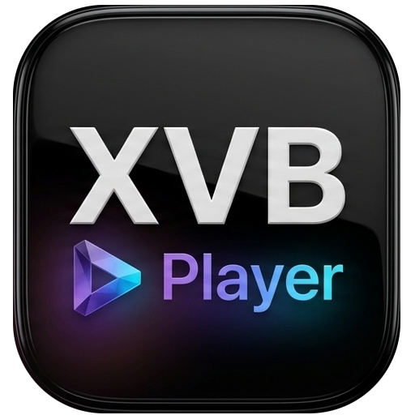
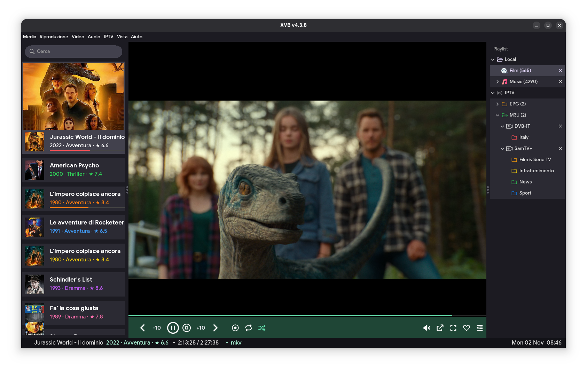

<h1>
  
  XVB Player
</h1>

**XVB Player** is a feature-rich, free, and open-source media player powered by `libmpv`. Designed for ultimate versatility, it seamlessly handles everything from local music, videos, DVDs, and ISO images to IPTV streams (with TV guides and recording) and live RTSP security camera feeds.

 

---

🍄 Liste Italia e EPG: 

---

- **IT:** [▶️ Guarda la dimostrazione su YouTube](https://www.youtube.com/watch?v=w5BYTwzUOBE)
- **EN:** [▶️ Watch the demonstration on YouTube](https://www.youtube.com/watch?v=w5BYTwzUOBE)
- **FR:** [▶️ Regarder la démonstration sur YouTube](https://www.youtube.com/watch?v=w5BYTwzUOBE)
- **ES:** [▶️ Ver la demostración en YouTube](https://www.youtube.com/watch?v=w5BYTwzUOBE)
- **DE:** [▶️ Demonstration auf YouTube ansehen](https://www.youtube.com/watch?v=w5BYTwzUOBE)
- **RU:** [▶️ Посмотреть демонстрацию на YouTube](https://www.youtube.com/watch?v=w5BYTwzUOBE)
- **PT:** [▶️ Assistir à demonstração no YouTube](https://www.youtube.com/watch?v=w5BYTwzUOBE)

---

### Support & Donations
If you find XVB Player useful, consider supporting its development:

---

## License

[MIT](LICENSE) © 2026 Jonathan Sanfilippo

