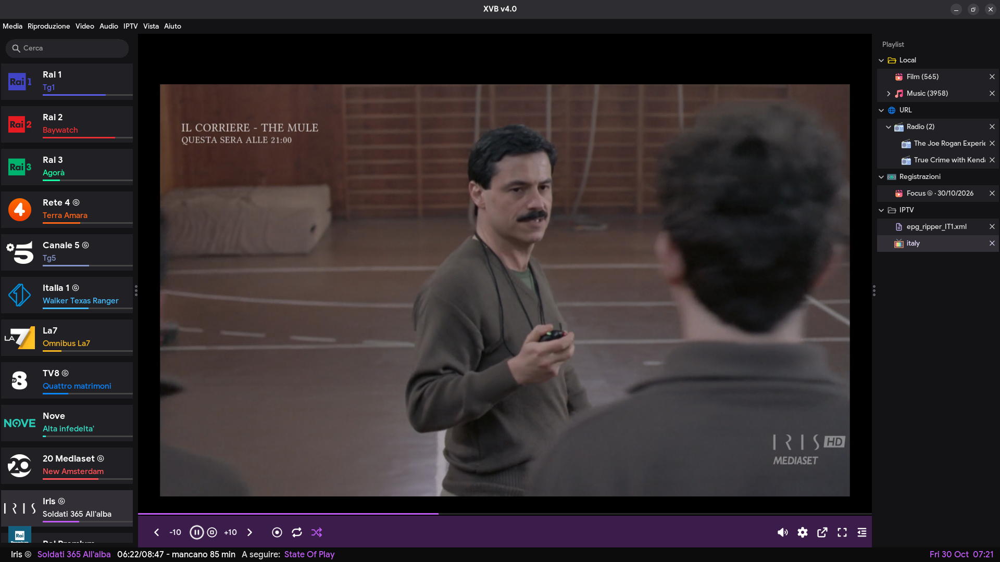

# XVB Player

🇮🇹 italian List m3u - free
[italy.zip](https://github.com/user-attachments/files/34136301/italy.zip)

🇮🇹 italian epg for this list
https://epgshare01.online/epgshare01/epg_ripper_IT1.xml.gz

⚠️ Requires an X11 session and is optimized for Debian 13.7 (Trixie)

A media player for Debian 13.7 , built on libmpv. It plays local
videos and music, video DVDs, data discs and ISO images, IPTV playlists with a TV
guide and recording, and RTSP network security cameras.



*[Versione italiana più sotto](#xvb-player-italiano).*

## Features

- Local videos and music, with resume, shuffle, repeat and seeking
- Open files and folders from the file manager (Open with XVB), by drag and drop, or from recent files
- Search the list by name, title, artist, album or year
- Media keys and the desktop sound panel (MPRIS): title, cover and controls
- Radio, music, film, and **RTSP/ONVIF security camera streams** by URL, saved with a name and a cover of your choice, or opened just once
- Titles, covers and posters fetched automatically (TMDB, MusicBrainz), also for untagged music from folder and file names
- Right-click: rename playlists, guides, streams and channels, set a cover or a channel logo
- Audio CDs, video DVDs (not encrypted), data discs and ISO images, several at once; Blu-ray is not supported
- IPTV: m3u playlists from file or URL, XMLTV guide
- **Advanced PVR recording**: stream dump for IPTV channels, radio, RTSP feeds, and unencrypted DVDs (supports instant and scheduled recordings)
- Controls drawn over the video, semi-transparent, hiding by themselves when only the video is shown
- Video and audio adjustments, hardware decoding (on by default), tracks, chapters, external subtitles (SRT, ASS/SSA) with delay and size synchronization, screenshots, picture in picture (PiP)
- Dark interface in English, Italian, Spanish, French, German, Portuguese and Russian, following the system language

## Installation & System Requirements

Supported system: **Linux Mint 22+ Debian 13+**.

⚠️ **Important Notice on Display Servers:** XVB Player is fully stable and optimized for **X11**. When running under Wayland, you may experience window management issues or interface glitches due to Tkinter limitations.

Download the `.deb` from the [latest release](../../releases/latest) and run:

```
sudo apt install ./xvb_*_all.deb
```

XVB is then available in the applications menu, or as `xvb` from a terminal.

To run it from source:

```
sudo apt install -y python3-tk python3-pil python3-pil.imagetk python3-mpv python3-mutagen ffmpeg libmpv2
git clone https://github.com/JonaDev2026/xvb.git ~/xvb
python3 ~/xvb/xvb.py
```

## Usage

- **Media** — open a file, a folder of videos and music, or a URL; recent files.
- **IPTV** — add playlists and TV guides, record and schedule recordings.
- **Playback**, **Video**, **Audio** — playback, picture and sound controls.
- **View** — full screen, layout and language.
- **Sidebar** — **Discs** (CDs, DVDs, ISO images), **Local** (media folders, imported files), **URL** (radio, music streams, film streams, RTSP cameras, temporary), **Recordings** and **IPTV** (playlists, TV guides).

| Key | Action |
|---|---|
| Space | Pause / resume |
| ← → | Previous / next |
| Shift + ← → | Seek 10 seconds |
| ↑ ↓ | Volume |
| M | Mute |
| Backspace | Previous channel (IPTV) |
| F11 | Full screen |

Settings are stored in `~/.config/xvb/`, recordings in `~/Videos/xvb/`.

## Legal

XVB is a neutral playback tool: it does not provide channels, credentials,
or content. Use XVB only with streams you are authorized to access. Avoid
piracy or any method to bypass copyright protections.

This product uses the TMDB API but is not endorsed or certified by TMDB.
Album covers from MusicBrainz and the Cover Art Archive.

## Support

XVB is free. If you find it useful, you can support its development via
[PayPal](https://www.paypal.com/paypalme/Jonathanuk).
Bugs and suggestions: [issues](../../issues).

## License

MIT © 2026 Jonathan Sanfilippo

---

# XVB Player (italiano)

Lettore multimediale per Linux Mint 22+, basato su libmpv. Riproduce
video e musica locali, DVD video, dischi di dati e immagini ISO, playlist IPTV con guida
TV e registrazione, e telecamere di videosorveglianza in rete (RTSP).

## Funzioni

- Video e musica locali, con ripresa, riproduzione casuale, ripetizione e avanzamento
- Apertura di file e cartelle dal file manager (Apri con XVB), trascinandoli sulla finestra o dai file recenti
- Ricerca nella lista per nome, titolo, artista, album o anno
- Tasti multimediali e pannello audio del desktop (MPRIS): titolo, copertina e comandi
- Radio, stream musicali, film e **telecamere di videosorveglianza IP (RTSP/ONVIF)** da URL, salvati con un nome e una copertina a scelta, o aperti una volta sola
- Titoli, copertine e poster scaricati in automatico (TMDB, MusicBrainz), anche per la musica senza tag a partire dai nomi di cartelle e file
- Clic destro: rinomina playlist, guide, stream e canali, imposta una copertina o il logo di un canale
- CD audio, DVD video (non cifrati), dischi di dati e immagini ISO, anche più insieme; Blu-ray non supportati
- IPTV: playlist m3u da file o URL, guida XMLTV
- **Registrazione avanzata PVR**: effettua il dump diretto del flusso di canali IPTV, radio, flussi RTSP e DVD non cifrati (supporta registrazioni istantanee o pianificate)
- Comandi disegnati sopra al video, semitrasparenti, che si nascondono da soli quando c'è solo il video
- Regolazioni video e audio, decodifica hardware (attiva di serie), tracce, capitoli, sottotitoli esterni (SRT, ASS/SSA) con sincronizzazione di ritardo e dimensione, istantanee, immagine nell'immagine (PiP)
- Interfaccia scura in inglese, italiano, spagnolo, francese, tedesco, portoghese e russo, secondo la lingua del sistema

## Installazione e Requisiti di Sistema

Sistema supportato: **Linux Mint 22+ Debian 13+**.

⚠️ **Nota importante sul server grafico:** XVB Player è completamente stabile e ottimizzato per **X11**. L'avvio sotto ambiente Wayland potrebbe causare problemi nella gestione delle finestre o glitch dell'interfaccia grafica a causa delle limitazioni di Tkinter.

Scarica il `.deb` dall'[ultima release](../../releases/latest) ed esegui:

```
sudo apt install ./xvb_*_all.deb
```

XVB si trova poi nel menu delle applicazioni, o come `xvb` da terminale.

Per avviarlo dal sorgente:

```
sudo apt install -y python3-tk python3-pil python3-pil.imagetk python3-mpv python3-mutagen ffmpeg libmpv2
git clone https://github.com/JonaDev2026/xvb.git ~/xvb
python3 ~/xvb/xvb.py
```

## Uso

- **Media** — apri un file, una cartella di video e musica, o un URL; file recenti.
- **IPTV** — aggiungi playlist e guide TV, registra e programma le registrazioni.
- **Playback**, **Video**, **Audio** — comandi di riproduzione, immagine e suono.
- **View** — schermo intero, layout e lingua.
- **Barra laterale** — **Discs** (CD, DVD, immagini ISO), **Local** (cartelle media, file importati), **URL** (radio, stream musicali, stream di film, telecamere RTSP, provvisori), **Recordings** e **IPTV** (playlist, guide TV).

| Tasto | Azione |
|---|---|
| Spazio | Pausa / riprendi |
| ← → | Precedente / successivo |
| Shift + ← → | Avanti / indietro di 10 secondi |
| ↑ ↓ | Volume |
| M | Muto |
| Backspace | Canale precedente (IPTV) |
| F11 | Schermo intero |

Le impostazioni sono in `~/.config/xvb/`, le registrazioni in `~/Videos/xvb/`.

## Note legali

XVB è uno strumento di riproduzione neutro: non fornisce canali,
credenziali o contenuti. Usa XVB solo con flussi a cui sei autorizzato
ad accedere. Niente pirateria né metodi per aggirare le protezioni del
copyright.

Questo prodotto usa le API di TMDB ma non è approvato né certificato da
TMDB. Copertine degli album da MusicBrainz e dal Cover Art Archive.

## Supporto

XVB è gratuito. Se ti è utile, puoi sostenerne lo sviluppo tramite
[PayPal](https://www.paypal.com/paypalme/Jonathanuk).
Bug e suggerimenti: [issues](../../issues).

## Licenza

MIT © 2026 Jonathan Sanfilippo
