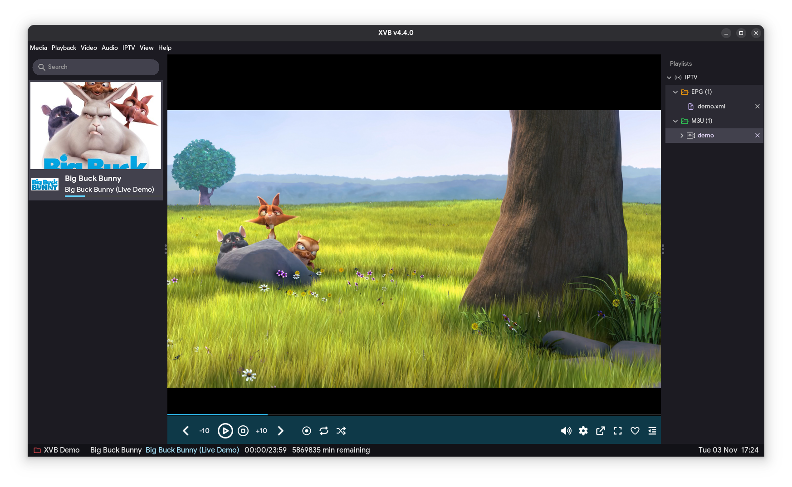

# XVB Player

A media player built on libmpv. It plays local videos and music, video
DVDs, data discs and ISO images, IPTV playlists with a TV guide and
recording, and RTSP network security cameras.



## Features

-   Local videos and music, with resume, shuffle, repeat and seeking.
-   Open files and folders from the file manager (Open with XVB), by
    drag and drop, or from recent files.
-   Search the list by name, title, artist, album or year.
-   Media keys and desktop sound panel (MPRIS): title, cover and
    playback controls.
-   Radio, music, film and **RTSP/ONVIF security camera streams** by
    URL, saved with a name and a cover of your choice, or opened just
    once.
-   Titles, covers and posters fetched automatically (TMDB,
    MusicBrainz), also for untagged music using folder and file names.
-   Right-click: rename playlists, guides, streams and channels, set a
    cover or a channel logo.
-   Audio CDs, video DVDs (not encrypted), data discs and ISO images,
    several at once. Blu-ray is not supported.
-   IPTV: M3U playlists from file or URL, XMLTV programme guide.
-   **Advanced PVR recording**: stream dump for IPTV channels, radio,
    RTSP feeds and unencrypted DVDs, supporting instant and scheduled
    recordings.
-   Controls drawn over the video, semi-transparent, hiding
    automatically when only the video is shown.
-   Video and audio adjustments, hardware decoding (enabled by default),
    tracks, chapters, external subtitles (SRT, ASS/SSA) with
    synchronized delay and size, screenshots and picture-in-picture
    (PiP).
-   Dark interface in English, Italian, Spanish, French, German,
    Portuguese and Russian, following the system language.

## Installation & System Requirements

### Supported Linux distributions

**Debian-based distributions** - Ubuntu 24.04 LTS - Linux Mint 22 -
Debian 13

Installation via prebuilt `.deb` package.

**Arch-based distributions** - Arch Linux - Manjaro - EndeavourOS -
CachyOS - Other Arch-based distributions compatible with the PKGBUILD.

Installation by building the package from source using `makepkg`.

Manjaro has been successfully tested.

### Display server

**X11 / Xorg session recommended and supported.**

XVB uses Tkinter and embeds libmpv video output through an X11 window ID
(`wid`). Native Wayland support is not currently available. Wayland
sessions use XWayland and have some known limitations.

### Installing on Debian-based distributions (.deb)

Download the `.deb` package from the [latest
release](../../releases/latest).

Install it using:

``` bash
sudo apt install ./xvb_*_all.deb
```

Once installed, XVB Player will be available in your applications menu
or via terminal by typing:

``` bash
xvb
```

### Installing on Arch-based distributions (PKGBUILD)

Arch-based distributions use `makepkg` to build and install XVB directly
from its PKGBUILD.

First, install the required build tools if they are not already
available:

``` bash
sudo pacman -S --needed base-devel git
```

Clone the XVB repository:

``` bash
git clone https://github.com/JonaDev2026/xvb.git
```

Enter the project directory:

``` bash
cd xvb
```

Build and install XVB:

``` bash
makepkg -si
```

The command automatically builds the package and installs the
dependencies declared in the PKGBUILD.

To update XVB, download the latest repository changes and rebuild:

``` bash
git pull
makepkg -si
```

No AUR account or third-party repository is required. XVB is distributed
directly through its official GitHub repository.

## Usage

-   **Media** --- Open a file, a folder containing videos/music, or a
    stream URL; access recent files.
-   **IPTV** --- Add playlists and TV guides, record streams and
    schedule recordings.
-   **Playback, Video, Audio** --- Playback controls, image adjustments
    and sound options.
-   **View** --- Toggle full screen, change layout and select language.
-   **Sidebar** --- Quick navigation for:
    -   **Discs** --- CDs, DVDs and ISO images.
    -   **Local** --- Media folders and imported files.
    -   **URL** --- Radio, music streams, film streams, RTSP cameras and
        temporary links.
    -   **Recordings** --- Recorded media.
    -   **IPTV** --- Playlists and TV guides.

### Keyboard shortcuts

  Key           Action
  ------------- -------------------------
  Space         Pause / Resume
  ← →           Previous / Next
  Shift + ← →   Seek 10 seconds
  ↑ ↓           Volume control
  M             Mute / Unmute
  Backspace     Previous channel (IPTV)
  F11           Toggle Full Screen

Configuration files and user settings are saved in `~/.config/xvb/`.

PVR recordings are stored in `~/Videos/xvb/`.

## Recommended Italian IPTV Playlist

XVB recommends the Italian free IPTV playlist provided by
[Free-TV](https://github.com/Free-TV/IPTV).

### Italy Playlist (Raw M3U)

[Open Italy M3U
Playlist](https://raw.githubusercontent.com/Free-TV/IPTV/master/playlists/playlist_italy.m3u8)

### Electronic Programme Guide (EPG)

For Italian TV programme information, XVB recommends the epgshare01 IT1
XMLTV source.

### Italy EPG (XML.GZ)

[Download Italy EPG --
IT1](https://epgshare01.online/epgshare01/epg_ripper_IT1.xml.gz)

Add the playlist and its EPG source through the XVB Playlist Manager.

## Known Issues

### Wayland

XVB is stable on X11. On Wayland sessions, it runs through XWayland
because video is embedded in the Tk window via an X11 window ID (mpv
`wid`), and Tkinter has no native Wayland backend.

Native Wayland is not supported.

Known limitations under XWayland:

-   **Menus and popups:** Dropdown menus may not close properly, may
    lose focus or may appear in the wrong position.
-   **Auto-hide of controls and cursor:** Pointer position is only
    tracked while the pointer is over an X window, so the control bar
    and overlays may not hide or show correctly.
-   **Always on top / PiP:** The "always on top" option is ignored by
    the compositor, and the PiP window cannot be positioned or kept on
    top.
-   **Drag and drop:** Dropping files from native Wayland apps may not
    work, even with tkdnd installed.
-   **Window icon:** The icon set by the app is ignored; the icon comes
    from the `.desktop` file.
-   **Screen blanking:** The screen may turn off during playback because
    idle inhibit is not implemented.

**Workaround:** Log in using an X11/Xorg desktop session.

## Legal

XVB Player is a neutral media playback tool. It does not provide, host
or distribute channels, credentials or copyrighted content. Use XVB only
with streams and media you are legally authorized to access. Avoid
piracy or circumventing digital protections.

This product uses the TMDB API but is not endorsed or certified by TMDB.
Album cover artwork is sourced from MusicBrainz and the Cover Art
Archive.

## Support

XVB is free and open-source. If you find this software useful, you can
support its development via
[PayPal](https://www.paypal.com/paypalme/Jonathanuk).

Report bugs or submit feature requests on the [GitHub
Issues](../../issues) page.

## License

MIT © 2026 Jonathan Sanfilippo
